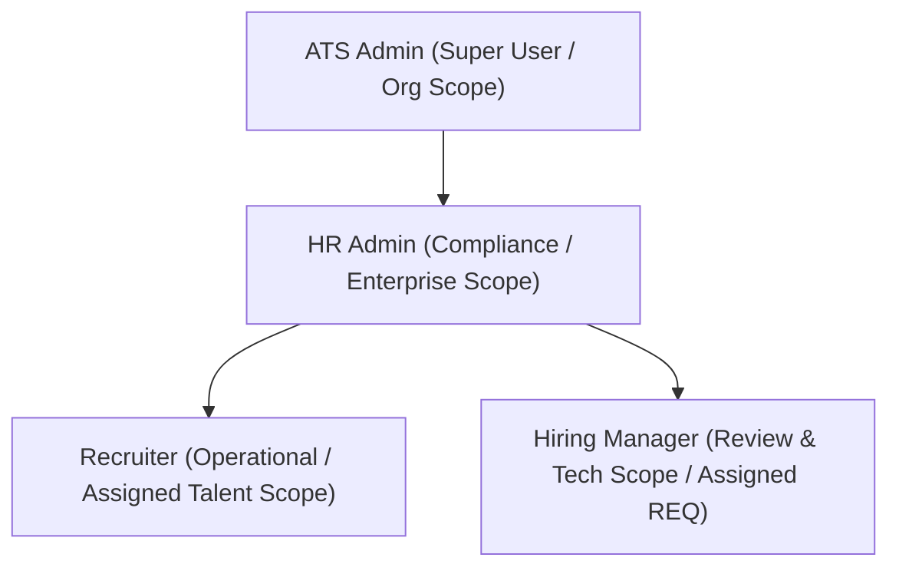

# Functional Requirement Specification (FRS)
## Module 5: Candidate Management & Repository
**Product:** PeopleWorks Enterprise ATS SaaS  
**Document Version:** 2.4  
**Date:** September 2026  
**Status:** Approved & Implemented  

---

## 1. Executive Summary & Objective

The **Candidate Management & Repository Module** serves as the unified single source of truth for all talent profiles across the enterprise. It manages the complete candidate journey from initial sourcing/ingestion, through multi-requisition application stages, interview evaluations, offer rollout, and onboarding handoff.

### Core Objectives:
1. **Candidate 360 Single View**: Decouple the candidate's core identity (person entity) from multiple job applications (job application entities).
2. **Deterministic Role-Based Governance**: Enforce strict separation of duties among Recruiters, Hiring Managers, HR Admins, and ATS Admins.
3. **Multi-Stage Pipeline Visibility**: Track candidate transitions across the 6 standard recruitment stages (`Applied` ➔ `Screening` ➔ `Shortlisted` ➔ `Interview` ➔ `Offer` ➔ `Hired`).
4. **Automated Deduplication & Compliance**: Prevent duplicate candidate entries using SHA-256 fingerprinting, email/phone collision detection, and full GDPR/EEOC audit logging.

---

## 2. Role-Based Access Control (RBAC) & Governance Matrix

The system provides 4 primary operational roles within the Candidate Module:



### Role Definitions & Responsibilities

| Role | Access Scope | Primary Responsibilities in Candidate Module | Permitted Actions |
| :--- | :--- | :--- | :--- |
| **1. Recruiter** | **Assigned Candidates & REQs** | Day-to-day candidate sourcing, initial screening, note-taking, advancing candidates through early stages (`Applied` ➔ `Screening` ➔ `Shortlisted`), and coordinating with Hiring Managers. | • Create & edit candidate profiles<br/>• Upload resumes and certificates<br/>• Advance/transition stages<br/>• Add recruiter screening notes<br/>• Export candidate lists |
| **2. Hiring Manager** | **Assigned Requisitions Only** | Technical gatekeeper for specific open positions. Reviews shortlisted candidates, inspects resumes/scorecards, provides technical endorsement, schedules technical interviews, and submits interview scorecards. | • View assigned candidates & JDs<br/>• Download parsed resumes<br/>• Submit HM technical feedback<br/>• Trigger technical interviews (R1/R2)<br/>• Recommend "Fit" or "Not a Fit" |
| **3. HR Admin** | **Organization-Wide Scope** | Oversees compliance, compensation approvals, background verification checks (BGV), offer letter generation, archival/restoration, and candidate data privacy requests. | • Organization-wide candidate access<br/>• Stage rollback / manager overrides<br/>• Extend & approve offer packages<br/>• Archive / restore candidate files<br/>• View full audit history |
| **4. ATS Admin** | **Global System Scope** | System administrator with unrestricted operational authority. Configures recruitment pipelines, resolves duplicate candidate conflicts, manages team assignments, and audits compliance logs. | • All Recruiter, HM & HR Admin permissions<br/>• Pipeline stage & custom field config<br/>• Hard delete / deduplication merging<br/>• User role & access delegation |

---

## 3. Step-by-Step Workflow by Role

### A. Recruiter Workflow
1. **Candidate Ingestion**: Recruiter creates a candidate profile manually or imports from Resume Intake (Module 4) / Job Postings (Module 3).
2. **Screening & Validation**: Recruiter evaluates AI screening score, checks notice period, and conducts initial phone screening.
3. **Shortlisting**: Recruiter marks candidate as `Shortlisted` and assigns the profile to the Hiring Manager's requisition queue.
4. **Status Updates**: Recruiter tracks progress and logs communication notes in the candidate's Activity Feed.

### B. Hiring Manager Workflow
1. **Queue Inspection**: HM logs into Candidate Repository and filters by their assigned requisition (e.g. `REQ-2026-0001`).
2. **Technical Review**: HM opens the candidate's 360 profile, reviews technical skills, and reads AI screening breakdown.
3. **Decision & Trigger**:
   - **Fit**: Endorses profile and clicks `Schedule Technical Interview (Round 1)`.
   - **Not a Fit**: Marks feedback with specific technical rejection reasons.

### C. HR Admin Workflow
1. **Offer Generation**: When candidate clears all technical rounds, HR Admin reviews feedback summary and drafts offer proposal.
2. **Compliance & Audit**: Verifies candidate identification documents and ensures salary is within approved requisition budget bands.
3. **Handoff**: Marks candidate as `Hired`, which automatically triggers employee onboarding handoff.

### D. ATS Admin Workflow
1. **Pipeline Governance**: ATS Admin monitors overall candidate distribution across all 6 stages.
2. **Conflict Resolution**: Resolves candidate duplicate signals (Merge records / Keep latest version).
3. **Overrides**: Unblocks stuck candidate transitions if an interviewer is on leave or an emergency stage override is required.

---

## 4. Candidate & Application Domain Model

The system separates **Candidate Identity** (Person Entity) from **Job Applications** (Requisition Attachment):

```
┌────────────────────────────────────────────────────────┐
│                   CANDIDATE (Person)                   │
│  ID: CAN-2026-0089                                     │
│  Name: Arjun Sharma                                    │
│  Email: arjun.sharma.qa@example.com                    │
│  Phone: +91 98765 43210                                │
│  Location: Bangalore, India                            │
│  Status: Active | Hired | Archived                     │
│  Created: 28/09/2026                                   │
└──────────────────────────┬─────────────────────────────┘
                           │ 1-to-Many
           ┌───────────────┴───────────────┐
           ▼                               ▼
┌──────────────────────────────┐ ┌──────────────────────────────┐
│     APPLICATION #1 (Active)  │ │   APPLICATION #2 (Archived)  │
│  App ID: APP-2026-104        │ │  App ID: APP-2025-042        │
│  REQ: REQ-2026-0001          │ │  REQ: REQ-2025-0089          │
│  Title: Senior QA Engineer   │ │  Title: SDET I               │
│  Stage: Interview            │ │  Stage: Shortlisted          │
│  Status: Active              │ │  Status: Rejected            │
└──────────────────────────────┘ └──────────────────────────────┘
```

---

## 5. 6-Stage Application Pipeline Specification

| Stage # | Stage Name | Entry Trigger | Exit Conditions / Actions | Next Stage |
| :---: | :--- | :--- | :--- | :--- |
| **1** | **Applied** | Ingestion via Resume Upload, Career Portal, or Job Boards | Profile verified by Recruiter | `Screening` |
| **2** | **Screening** | AI Parsing & Requisition Skill Benchmark match | Screening score generated (≥60%) & recruiter note logged | `Shortlisted` / `Rejected` |
| **3** | **Shortlisted** | Recruiter clicks "Mark as Shortlisted" | HM reviews and endorses profile for tech assessment | `Interview` / `Rejected` |
| **4** | **Interview** | Recruiter schedules interview session upon HM recommendation | Technical rounds (R1, R2, HR) completed with feedback | `Offer` / `Rejected` |
| **5** | **Offer** | Hiring Panel recommends candidate for offer | Offer letter approved by HOD/Finance and accepted by candidate | `Hired` / `Withdrawn` |
| **6** | **Hired** | Signed offer received & start date confirmed | Candidate profile exported to HRIS / Onboarding | Completed |

---

## 6. UI & Architectural Standards

1. **2-Card Uniform Architecture**:
   - **Card 1**: Entity Header with `< Back`, Candidate Full Name, Live Status Badge, Candidate ID (`CAN-2026-XXXX`), Match Score Pill, and contextual action buttons.
   - **Metadata Grid**: 4-column x 2-row structured aligned grid displaying linked REQ, Current Role, Total Experience, Sourcing Channel, Email, Phone, Location, and Reference ID.
   - **Card 2**: Mild blue glassmorphic Lifecycle Stepper showing all stages with checkmarks and active stage highlights.
2. **Brand Dynamic Color Rule**:
   - All primary action buttons, active tab pills, and badges dynamically inherit `var(--pw-brand)` / `brandColor`.
   - Hardcoded black or dark slate buttons (`bg-slate-900`, `bg-black`, `#000000`) are strictly prohibited.
3. **Zero Informal Emojis**:
   - All statuses and action buttons must strictly use enterprise Lucide React SVG icons (`<CheckCircle2 />`, `<Calendar />`, `<Award />`, `<X />`, `<ThumbsUp />`).

---

## 7. Cross-Module Data Integrations

- **Module 1 (Requisitions)**: Candidate application directly binds to `requisitionId` and honors approved salary budget bands.
- **Module 2 (Job Descriptions)**: AI match scoring benchmarks candidate skill extraction against active JD requirements.
- **Module 3 (Job Postings)**: Sourcing attribution records the exact channel (LinkedIn, Indeed, Naukri, Portal).
- **Module 4 (Resume Intake)**: Ingested resumes sync to candidate records with SHA-256 fingerprint deduplication.
- **Module 5 (Interviews)**: Stage transitions to `Interview` automatically create scheduled interview slots in `DatabaseService.interviews`.

---

**End of Specification**
